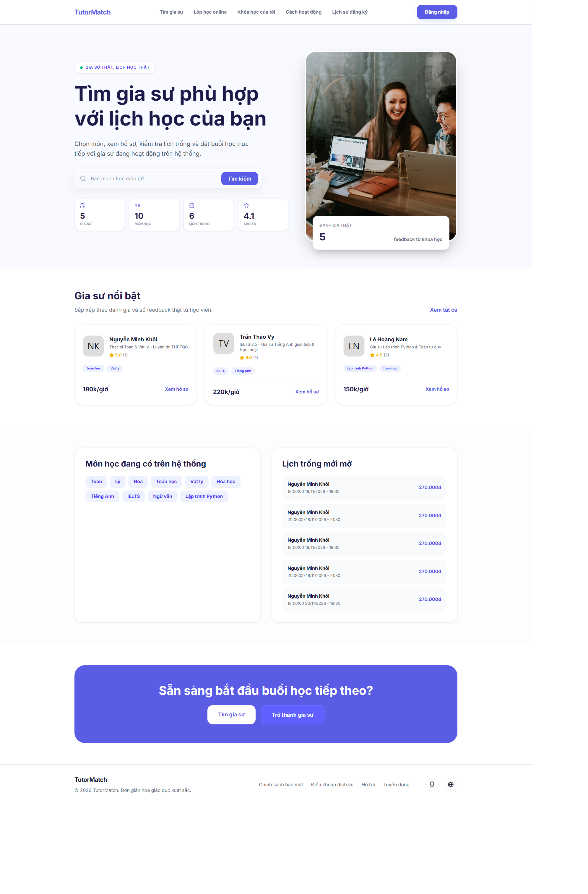
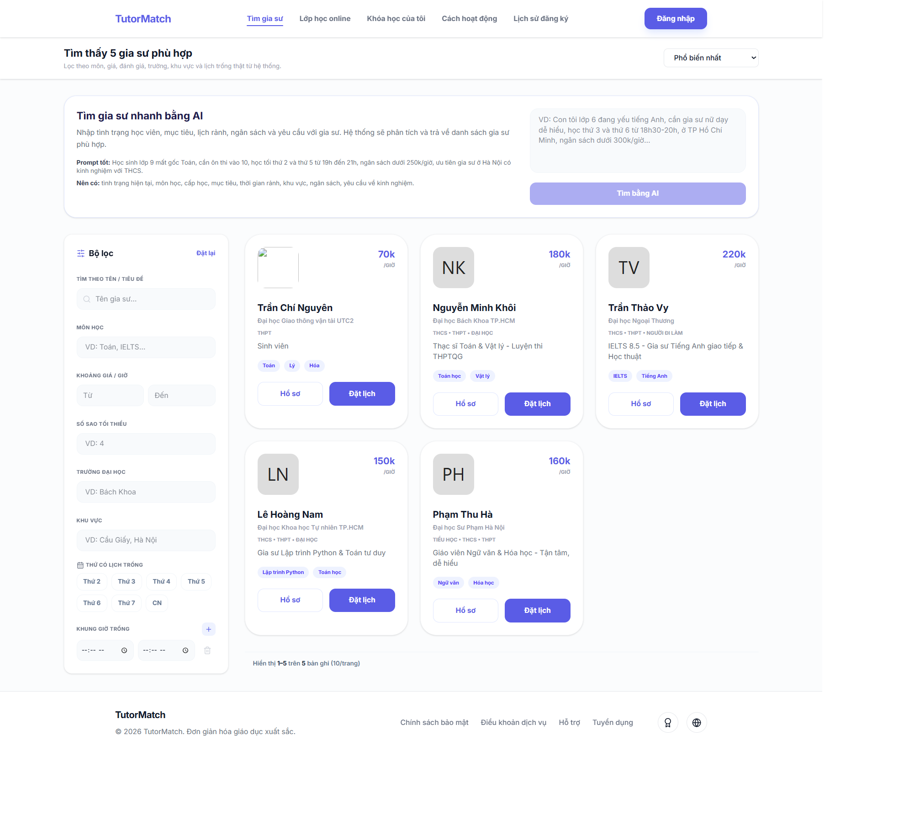
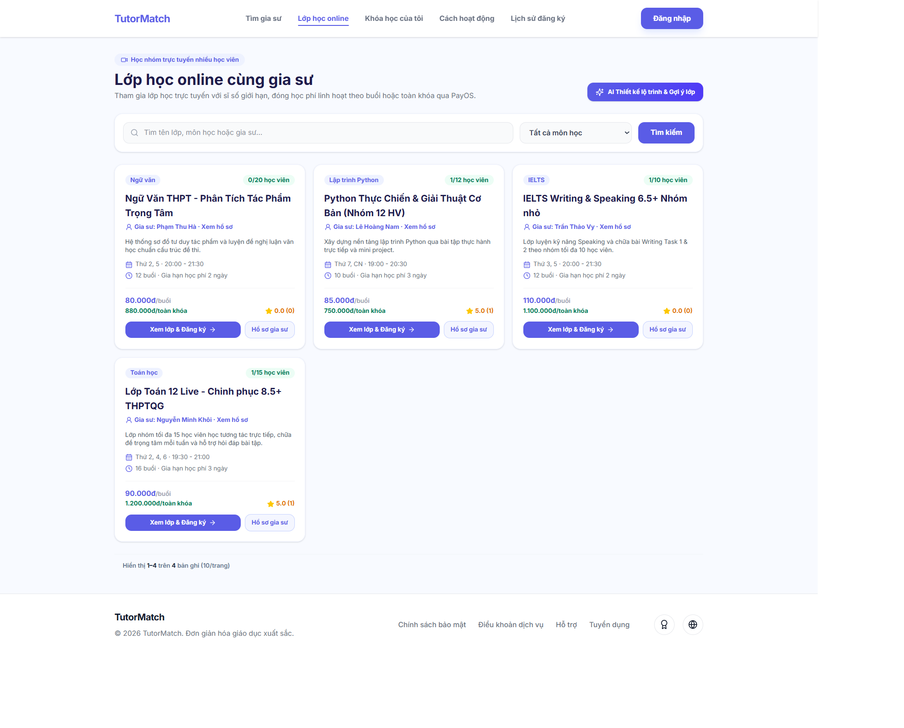
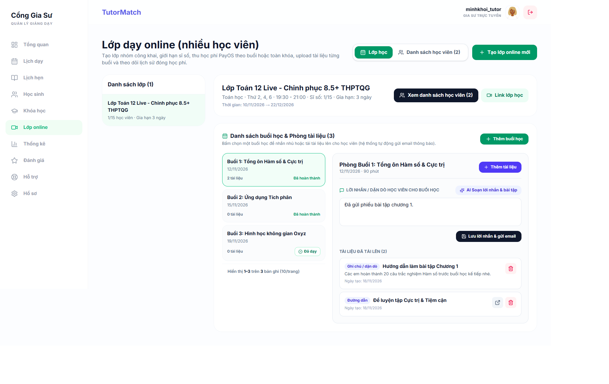
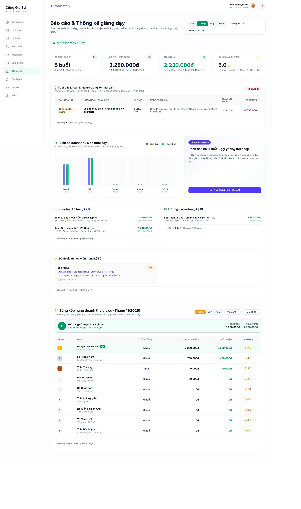
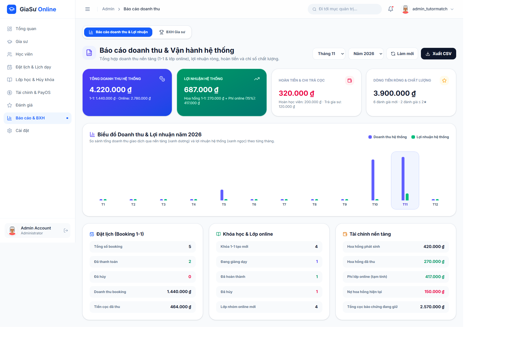
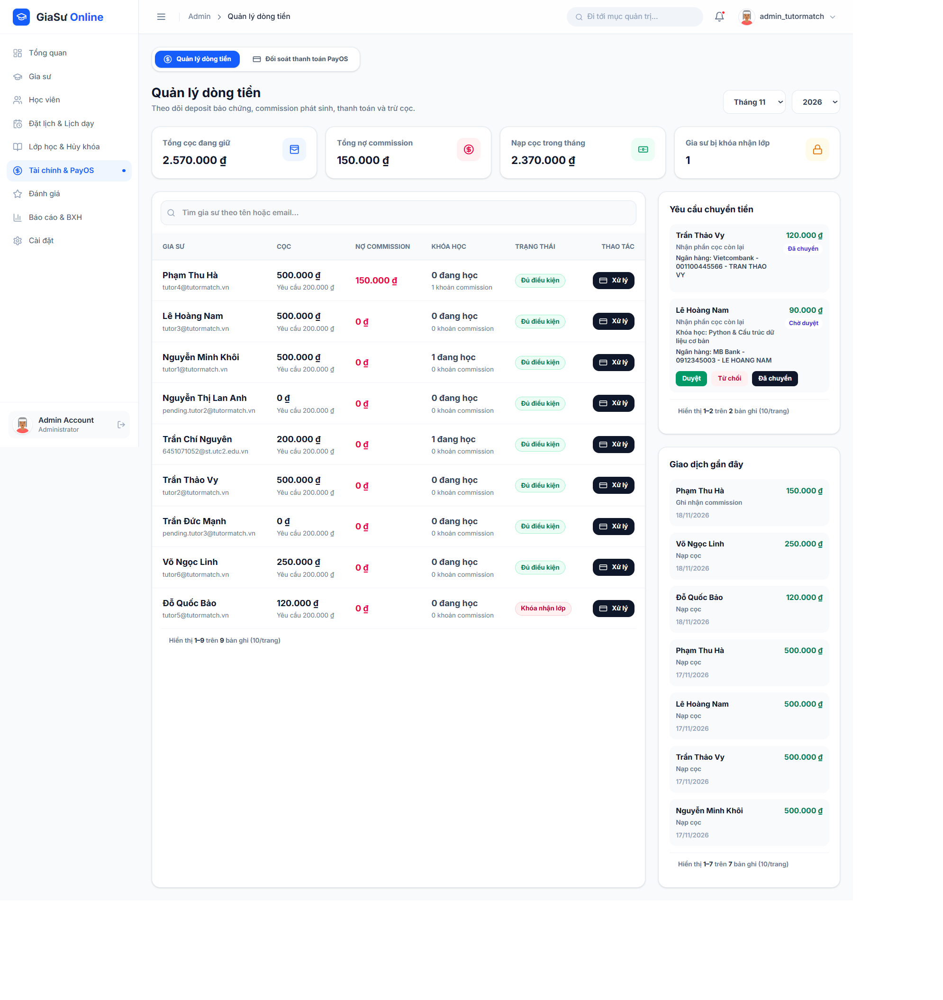

<h1 align="center">
  🎓 TutorMatch – Nền tảng kết nối Gia sư & Học viên Trực tuyến
</h1>

<p align="center">
  <strong>Nền tảng EdTech Full-Stack kết hợp Đặt lịch học 1-1, Lớp học Online nhiều học viên, Ký quỹ bảo chứng, Thanh toán PayOS, Chat Real-time & Trợ lý AI</strong>
</p>

<!-- HIGHLIGHT CÔNG NGHỆ SỬ DỤNG -->
<p align="center">
  
  
  
  
  
  
  
  
  
  
  
</p>

<p align="center">
  <strong>Core Stack:</strong> Django 5 + DRF · Django Channels (WebSocket) · Celery + Celery Beat · FastAPI AI Microservice · React 18 + Vite 5 + TailwindCSS 4 · Zustand + TanStack Query · PostgreSQL 16 · Redis 7 · PayOS Gateway
</p>

---

## 📋 Mục lục

1. [Khái quát hệ thống](#1-khái-quát-hệ-thống)
2. [Bối cảnh và Mục đích](#2-bối-cảnh-và-mục-đích)
3. [Công nghệ sử dụng, Lý do chọn và Công dụng](#3-công-nghệ-sử-dụng-lý-do-chọn-và-công-dụng)
4. [Kiến trúc tổng thể hệ thống](#4-kiến-trúc-tổng-thể-hệ-thống)
5. [Các chức năng của hệ thống](#5-các-chức-năng-của-hệ-thống)
6. [Mô tả các module trọng tâm](#6-mô-tả-các-module-trọng-tâm)
7. [Cấu trúc thư mục](#7-cấu-trúc-thư-mục)
8. [Hướng dẫn chạy cục bộ & Demo](#8-hướng-dẫn-chạy-cục-bộ--demo)
9. [Tài liệu chi tiết](#9-tài-liệu-chi-tiết)

---

## 1. Khái quát hệ thống

**TutorMatch (GiaSư Online)** là nền tảng web toàn diện hỗ trợ kết nối, quản lý giảng dạy và đối soát tài chính giữa **Học viên**, **Gia sư** và **Quản trị viên (Admin)**. Hệ thống vận hành song song hai mô hình đào tạo trực tuyến chính:

- **Khóa học 1-1 (One-on-One Tutoring)**: Học viên tìm kiếm gia sư theo môn học, khung giờ rảnh hàng tuần và ngân sách; đặt lịch kèm thanh toán cọc qua **PayOS**; học qua lịch buổi học có phòng tài liệu và nghiệm thu tiến độ từng buổi.
- **Lớp học Online theo nhóm (Online Group Classes)**: Gia sư tự mở lớp nhóm với sĩ số giới hạn, thu học phí linh hoạt **theo buổi** hoặc **toàn khóa** qua PayOS, quản lý phòng học & gửi email thông báo tài liệu từng buổi, kèm cơ chế tự động nhắc hạn học phí và xử lý rời lớp / hoàn tiền pro-rata minh bạch.

Toàn bộ dòng tiền được bảo vệ bằng cơ chế **Ký quỹ bảo chứng (Guarantee Deposit)** đối với gia sư, quản lý công nợ hoa hồng (`commission_debt`), hỗ trợ lưu thông tin tài khoản ngân hàng & mã QR chuyển khoản cho cả học viên và gia sư để phục vụ hoàn tiền và giải ngân.

---

## 2. Bối cảnh và Mục đích

### Bối cảnh thực tế
Việc tìm gia sư và tổ chức dạy học trực tuyến hiện nay thường rời rạc qua mạng xã hội hoặc nhóm chat tự phát, dẫn đến nhiều rủi ro:
- **Thiếu minh bạch chất lượng & lịch học**: Khó kiểm chứng trình độ, CV, học phí theo giờ và lịch trống thực tế của gia sư.
- **Rủi ro tài chính & hủy ngang**: Gia sư nhận lớp nhưng bỏ dạy giữa chừng hoặc chậm hoàn phí nền tảng; ngược lại học viên không có cơ chế hoàn cọc / hoàn học phí chưa học rõ ràng khi hủy khóa hoặc rời lớp.
- **Khó quản lý học phí định kỳ & tài liệu**: Khi dạy lớp nhóm online nhiều học viên đóng tiền theo từng đợt khác nhau, việc theo dõi hạn đóng, nhắc gia hạn, gửi tài liệu buổi học và đối soát doanh thu - lợi nhuận thủ công rất dễ sai sót.

### Mục đích xây dựng
**TutorMatch** được phát triển nhằm số hóa khép kín quy trình dạy và học trực tuyến với 4 mục tiêu trọng tâm:
1. **Chuẩn hóa quy trình kết nối & duyệt hồ sơ**: Xác thực tài khoản qua Email OTP / Google OAuth2, kiểm duyệt hồ sơ gia sư (kèm CV công khai, bằng cấp, chứng chỉ) trước khi cho phép nhận lớp.
2. **An toàn tài chính 2 chiều**: Kết hợp cổng thanh toán **PayOS** (chống tạo trùng đơn idempotent), **cọc bảo chứng gia sư**, lưu **STK + ảnh QR ngân hàng** cho cả học viên & gia sư để đối soát hoàn cọc/rút tiền chuẩn xác.
3. **Tự động hóa vận hành bằng Worker & AI**: Dùng Celery Beat nhắc hạn học phí tự động và gửi email tài liệu; tích hợp **FastAPI AI Service** hỗ trợ lập lộ trình học, gợi ý gia sư/lớp phù hợp, soạn giáo án/bài tập cho gia sư và phân tích hiệu suất doanh thu.
4. **Minh bạch số liệu & phân trang hiệu năng cao**: Báo cáo doanh thu - lợi nhuận hệ thống, bảng xếp hạng doanh thu gia sư theo Tuần/Tháng/Quý/Năm và chuẩn phân trang SQL `10 bản ghi/trang` đồng bộ trên mọi cổng.

---

## 3. Công nghệ sử dụng, Lý do chọn và Công dụng

### 3.1 Backend & Real-time Services

| Công nghệ | Phiên bản | Lý do lựa chọn | Công dụng trong dự án |
|---|---|---|---|
| **Python + Django + DRF** | Django `5.0.*` / DRF `3.15.*` | Hệ sinh thái ORM mạnh, bảo mật tốt, hỗ trợ migration & transaction atomic cho các nghiệp vụ tài chính nhạy cảm. | Xử lý toàn bộ REST API (`/api/*`), phân quyền Student/Tutor/Admin, quản lý booking, khóa học, lớp online, đối soát dòng tiền và phân trang SQL (`StandardResultsSetPagination`, `10/trang`). |
| **PostgreSQL** | `16-alpine` | Hệ quản trị CSDL quan hệ chuẩn ACID, hỗ trợ transaction lock & aggregation phức tạp. | Lưu trữ toàn bộ dữ liệu giao dịch, sổ cái `TutorGuaranteeTransaction`, `Booking`, `Course`, `OnlineClass`, `OnlineClassPayment`, log hoàn tiền và báo cáo. |
| **Redis** | `7-alpine` | Tốc độ in-memory cực cao, dùng chung được cả cho cache, Celery broker và WebSocket Pub/Sub. | Caching danh sách công khai (với cache-invalidation theo nhóm), hàng đợi message broker cho Celery và Channel Layer cho WebSocket chat. |
| **Celery + Celery Beat** | `celery` + `django-celery-beat` | Tách biệt tác vụ nặng/định kỳ khỏi luồng HTTP để API phản hồi tức thì và đảm bảo thứ tự thanh toán. | Chạy 3 queue chuyên biệt: `celery` (gửi email OTP, email tài liệu buổi học), `payments` (`concurrency=1` để verify PayOS an toàn), `ai` (kiểm duyệt review) + `celery_beat` nhắc hạn học phí & xử lý quá hạn hàng ngày. |
| **Django Channels + Daphne** | ASGI Server | Hỗ trợ chuẩn WebSocket ngay trên cùng mô hình auth và ORM của Django. | Phục vụ giao tiếp Chat real-time (cổng `8001`) và cập nhật thông báo tức thì giữa học viên và gia sư. |
| **SimpleJWT + Google Auth** | `simplejwt` + `google-auth` | Stateless JWT gọn nhẹ cho SPA React, hỗ trợ blacklist token khi đăng xuất và OAuth2 tiện lợi. | Xác thực người dùng đa vai trò qua Access/Refresh JWT và đăng nhập nhanh bằng tài khoản Google. |
| **PayOS Gateway** | REST + Webhook | Hỗ trợ chuyển khoản VietQR nội địa Việt Nam phổ biến, webhook xác thực tự động theo thời gian thực. | Thu tiền cọc 20% khi đặt lịch 1-1 và thu học phí theo buổi / toàn khóa ở lớp học online. |

### 3.2 AI Microservice

| Công nghệ | Phiên bản | Lý do lựa chọn | Công dụng trong dự án |
|---|---|---|---|
| **FastAPI + Uvicorn** | `0.115.6` / `0.34.0` | Tốc độ cao, validate schema bằng Pydantic chặt chẽ, tách riêng workload AI khỏi Django monolith. | Chạy dịch vụ AI độc lập tại cổng `8010`, cung cấp endpoint gợi ý lộ trình học, soạn bài giảng & phân tích hiệu suất. |
| **OpenAI GPT-4.1-mini** | `openai==1.59.7` | Chi phí tối ưu, phản hồi JSON có cấu trúc tốt với tiếng Việt chuyên ngành giáo dục. | Tư vấn lộ trình học từ mục tiêu người dùng, sinh khung buổi học + câu hỏi luyện tập, phân tích hiệu suất gia sư và kiểm duyệt ngôn từ đánh giá (có heuristic fallback an toàn). |

### 3.3 Frontend

| Công nghệ | Phiên bản | Lý do lựa chọn | Công dụng trong dự án |
|---|---|---|---|
| **React + TypeScript + Vite** | React `18.2` / TS `5.2` / Vite `5.0` | Kiến trúc component tái sử dụng cao, type-safe giảm lỗi runtime, HMR build cực nhanh. | Xây dựng giao diện SPA cho cả 3 cổng: Học viên (`Client`), Gia sư (`/tutor/*`) và Quản trị (`/admin/*`). |
| **TailwindCSS** | `4.2` | Utility-first styling linh hoạt, dễ chuẩn hóa design system (bảng biểu, modal, pagination, card KPI). | Thiết kế giao diện responsive tiếng Việt đồng bộ, biểu đồ SVG/CSS trực quan ở trang Báo cáo & Thống kê. |
| **Zustand + Axios** | Zustand `4.4` / Axios `1.6` | Quản lý state gọn hơn Redux, Axios interceptor tự động gắn Bearer Token & refresh token. | Lưu state dashboard/admin store (`useAdminStore`, `useTutorStore`), xử lý multipart upload CV/tài liệu/ảnh QR ngân hàng. |
| **Framer Motion + Lucide** | Motion `10.18` / Lucide `0.462` | Hiệu ứng chuyển cảnh mượt mà và bộ icon sắc nét đồng nhất. | Nâng cao trải nghiệm UI ở các modal chi tiết, thẻ khóa học và thanh điều hướng. |

### 3.4 Hạ tầng & DevOps

| Công nghệ | Công dụng trong dự án |
|---|---|
| **Docker & Docker Compose** | Đóng gói đồng bộ 11 containers (`postgres`, `redis`, `django`, `channels`, `ai_service`, `celery_worker`, `celery_payment_worker`, `celery_ai_worker`, `celery_beat`, `frontend`, `pgadmin`) giúp chạy dự án bằng 1 câu lệnh, không xung đột môi trường. |
| **Nginx & AWS S3 (Production)** | Reverse proxy điều hướng HTTP/WS và `django-storages`/`boto3` lưu trữ media/CV/QR trên S3 khi deploy production. |

---

## 4. Kiến trúc tổng thể hệ thống

TutorMatch được tổ chức theo kiến trúc **Modular Monolith + Isolated AI Microservice**:

```
┌──────────────────────────────────────────────────────────────────────────┐
│                        CLIENT (React 18 + Vite SPA)                      │
│                Student Portal  │  Tutor Portal  │  Admin Portal           │
└───────────────────┬────────────────────────────────────┬─────────────────┘
                    │ REST API (JSON / Multipart)         │ WebSocket
                    ▼ http://localhost:8002/api/          ▼ ws://localhost:8001
      ┌─────────────────────────────┐      ┌──────────────────────────────┐
      │     Django REST API         │      │   Daphne / Django Channels   │
      │     (Gunicorn :8000->8002)  │      │   (ASGI WebSocket Server)    │
      └──────┬─────────────┬────────┘      └──────────────┬───────────────┘
             │             │                              │
             │             └──────────────┬───────────────┘
             ▼                            ▼
┌─────────────────────────┐  ┌─────────────────────────────────────────────┐
│     PostgreSQL 16       │  │                  Redis 7                    │
│  (Primary Database)     │  │  Read Cache │ Channel Layer │ Celery Broker │
└─────────────────────────┘  └──────────────┬──────────────────────────────┘
                                            │
                       ┌────────────────────┴────────────────────┐
                       ▼                                         ▼
        ┌──────────────────────────────┐          ┌────────────────────────────┐
        │       Celery Workers         │          │   FastAPI AI Service       │
        │  • celery_worker (email)     │ ──HTTP─► │   (:8010)                  │
        │  • celery_payment_worker (1) │          │   • Learning Roadmap       │
        │  • celery_ai_worker (2)      │          │   • Lesson Assistant       │
        │  • celery_beat (scheduler)   │          │   • Performance Insights   │
        └──────────────────────────────┘          └────────────────────────────┘
```

### Luồng vận hành chính
1. **Luồng REST API & Phân trang**: React gọi `/api/*` qua Axios; Django kiểm tra JWT role (`AllowAny` / `IsAuthenticated` / `IsAdminUser`), thực thi nghiệp vụ trong transaction và trả JSON đã cắt lát SQL (`page_size=10`).
2. **Luồng Thanh toán PayOS bất đồng bộ**: Tạo link PayOS → Học viên thanh toán → Webhook/Verify (`celery_payment_worker` với `concurrency=1`) đảm bảo tạo `Course` hoặc kích hoạt `OnlineClassEnrollment` duy nhất 1 lần (idempotent).
3. **Luồng Tác vụ nền & Nhắc hạn**: `celery_worker` gửi email thông báo tài liệu mới/mời rời lớp/OTP; `celery_beat` chạy cron mỗi ngày kiểm tra học viên sắp đến hạn đóng học phí (trước 2 ngày) hoặc quá hạn (`payment_grace_days`) để tự động khóa ghi danh chưa nộp tiền.
4. **Luồng AI Proxy an toàn**: Frontend gọi qua `apps/ai_proxy` trên Django (không lộ key hoặc endpoint nội bộ của `ai_service`); `ai_proxy` kết hợp dữ liệu thực tế từ PostgreSQL với kết quả AI từ FastAPI `:8010`.

---

## 5. Các chức năng của hệ thống

| Vai trò | Nhóm chức năng chính |
|---|---|
| **Học viên (Client)** | • Đăng ký/đăng nhập (Email + OTP, Google OAuth2), đổi mật khẩu, lưu **tài khoản ngân hàng & ảnh QR hoàn tiền** (`/profile`).<br>• Tìm gia sư 1-1 nâng cao theo môn, giá, đánh giá, ngày trong tuần & khung giờ.<br>• Dùng **AI Thiết kế lộ trình học** gợi ý gia sư 1-1 và lớp online phù hợp.<br>• Đặt lịch theo slot, thanh toán cọc qua PayOS, theo dõi tiến độ từng buổi học, tải tài liệu, yêu cầu gia hạn/hủy khóa hoàn cọc.<br>• Đăng ký lớp học online theo buổi hoặc toàn khóa, gia hạn học phí kỳ tiếp theo, đánh giá sao gia sư và chat real-time. |
| **Gia sư (Tutor)** | • Đăng ký hồ sơ gia sư, cập nhật thông tin cá nhân, **môn dạy & học phí/giờ**, upload **CV công khai**, lưu **tài khoản ngân hàng & ảnh QR nhận tiền**.<br>• Thiết lập lịch dạy tuần, duyệt/từ chối booking, quản lý học viên & khóa học 1-1 (thêm buổi, upload tài liệu).<br>• Mở lớp học online (chọn môn đã đăng ký, lịch học tuần bằng checkbox, ngày bắt đầu/kết thúc), quản lý phòng buổi học (nhắn nhủ + upload tài liệu tự động gửi email cho học viên, **AI Soạn giáo án**), xem nhật ký đóng học phí & mời học viên rời lớp có minh chứng.<br>• Nạp/theo dõi **cọc bảo chứng**, thanh toán nợ hoa hồng, gửi yêu cầu nhận cọc/rút khỏi nền tảng kèm ảnh QR.<br>• Xem **Báo cáo & Thống kê** (Tuần/Tháng/Quý/Năm), bảng chi tiết các khoản khấu trừ, BXH doanh thu gia sư & gửi yêu cầu hỗ trợ tới Admin. |
| **Quản trị viên (Admin)** | • **Tổng quan**: KPI hệ thống theo tháng, dòng tiền cọc/hoa hồng và cảnh báo cần xử lý.<br>• **Gia sư** (`Quản lý gia sư` + `Duyệt hồ sơ`): Phê duyệt/từ chối hồ sơ mới, khóa/mở tài khoản, trừ nợ commission từ cọc.<br>• **Học viên**: Quản lý danh sách, khóa/mở khóa/xóa, **xem chi tiết học viên** (hồ sơ, ngân hàng/QR, khóa học 1-1 & online, tổng tiền đã đóng, các bài đánh giá).<br>• **Đặt lịch & Lịch dạy**: Giám sát toàn bộ Booking và Slot dạy toàn hệ thống.<br>• **Lớp học & Hủy khóa**: Quản lý Khóa học 1-1 (xem tài liệu từng buổi), Lớp học online (chạy worker nhắc hạn, xử lý kick/hoàn tiền kèm STK/QR học viên) và duyệt **Yêu cầu hủy khóa** hoàn cọc.<br>• **Tài chính & PayOS**: Quản lý cọc bảo chứng, trừ nợ commission, duyệt/từ chối/đánh dấu đã chuyển cho **Yêu cầu chuyển tiền của gia sư** (hiển thị STK + ảnh QR), đối soát giao dịch PayOS.<br>• **Đánh giá**: Kiểm duyệt review thấp sao, xử lý khiếu nại đánh giá.<br>• **Báo cáo & BXH**: **Báo cáo Doanh thu & Lợi nhuận hệ thống** (biểu đồ 12 tháng + xuất CSV UTF-8 BOM) và **BXH Gia sư** (Top doanh thu cao & Doanh thu kém kèm AI Phân tích / Loại bỏ).<br>• **Cài đặt**: Cấu hình tham số toàn cục (mức cọc tối thiểu, % hoa hồng, số ngày hạn nợ). |

---

## 6. Mô tả các module trọng tâm

Để dễ tra cứu chuyên sâu cho từng nghiệp vụ và cấu trúc bảng/API tương ứng, dự án tách tài liệu nghiệp vụ của 4 module cốt lõi tại thư mục `docs/`:

1. **[Module 1: Nghiệp vụ Gia sư, Phê duyệt & Ký quỹ bảo chứng (`docs/business-tutor-guarantee.md`)](docs/business-tutor-guarantee.md)**
   - Quy trình duyệt hồ sơ `RegistrationProfile → TutorProfile`, điều kiện mở khóa nhận lớp (`guarantee_deposit_balance >= required_deposit`), sổ cái `TutorGuaranteeTransaction`, tính/thu hồi nợ hoa hồng (`commission_debt`) và xử lý yêu cầu rút tiền/rời nền tảng (`platform_exit`) qua ảnh QR.
2. **[Module 2: Nghiệp vụ Đặt lịch 1-1, Khóa học, Hủy khóa & Hoàn cọc (`docs/business-booking-courses.md`)](docs/business-booking-courses.md)**
   - Vòng đời `TeachingSlot → Booking → PayOS Atomic Verify → Course → CourseSession`, ghi nhận hoàn thành buổi học, gia hạn khóa và quy trình hủy khóa hoàn cọc dựa trên hồ sơ ngân hàng học viên.
3. **[Module 3: Nghiệp vụ Lớp học Online nhiều học viên, PayOS theo kỳ & Hoàn tiền (`docs/business-online-classes.md`)](docs/business-online-classes.md)**
   - Quản lý `OnlineClass`, phòng buổi học & tự động gửi email tài liệu, đóng học phí chu kỳ `per_session` / `full_course`, Celery worker nhắc hạn trước 2 ngày & khóa quá hạn, cùng công thức hoàn tiền **pro-rata** khi gia sư mời rời lớp có minh chứng.
4. **[Module 4: Nghiệp vụ Tài chính, QR ngân hàng, Báo cáo Lợi nhuận, BXH & AI (`docs/business-finance-analytics-ai.md`)](docs/business-finance-analytics-ai.md)**
   - Chuẩn hóa lưu trữ STK/QR ngân hàng, công thức tính **Tổng doanh thu (GMV)** & **Lợi nhuận hệ thống (`system_profit`)** theo tháng và chuỗi 12 tháng, thống kê gia sư giải thích rõ từng khoản khấu trừ, BXH Top/Kém doanh thu, tích hợp 4 tính năng AI và cơ chế phân trang `10 bản ghi/trang`.

---

## 7. Cấu trúc thư mục

```text
GiaSuOnline/
├── backend/                          # Django 5 + DRF REST API & Celery Workers
│   ├── apps/
│   │   ├── users/                    # Auth (JWT, Google OAuth, OTP), CustomUser (Bank/QR), seed_data
│   │   ├── tutors/                   # Hồ sơ gia sư công khai, Môn dạy, Ký quỹ bảo chứng, Thống kê & BXH
│   │   ├── bookings/                 # TeachingSlot, Booking 1-1, PayOS cọc 20%, Hỗ trợ/khiếu nại
│   │   ├── courses/                  # Course 1-1, Buổi học, Tài liệu, Review, Hủy khóa & Hoa hồng
│   │   ├── online_classes/           # Lớp nhóm online, Phòng buổi học, PayOS theo kỳ, Kick/Hoàn tiền, Workers
│   │   ├── chat/                     # WebSocket Chat Rooms & Tin nhắn real-time (Django Channels)
│   │   ├── notifications/            # Email SMTP bất đồng bộ & Thông báo in-app
│   │   ├── ai_reviews/               # Model kết quả AI Review
│   │   ├── ai_proxy/                 # Proxy gọi FastAPI AI Service + Fallback
│   │   └── admin_portal/             # REST API quản trị: Tài chính, Chi tiết HV, Báo cáo Lợi nhuận, Cài đặt
│   ├── config/                       # Settings (base/development/production), URL routing, Celery & ASGI
│   ├── core/                         # Pagination (10/trang SQL slicing), Read-cache Redis, Shared utils
│   └── requirements/                 # base.txt, development.txt, production.txt
│
├── ai_service/                       # Microservice AI độc lập (FastAPI :8010)
│   └── app/
│       ├── routers/                  # Assistant, Review, Moderation endpoints
│       ├── services/                 # Tích hợp OpenAI GPT-4.1-mini & Fallback logic
│       └── schemas/                  # Pydantic schemas
│
├── frontend/                         # React 18 + TypeScript + Vite + TailwindCSS 4
│   └── src/
│       ├── api/                      # Axios client + modules (admin, bookings, courses, onlineClasses, rooms)
│       ├── components/
│       │   ├── layout/               # Client Header/Footer, TutorLayout, AdminLayout (9 mục gọn)
│       │   └── ui/                   # Pagination (10/trang), Toast, UI primitives
│       ├── hooks/                    # useTutors, useCourses, useDebounce...
│       ├── pages/
│       │   ├── Admin/                # Dashboard, AdminWorkspaces, UserManagement, Finance, Reports, Rankings...
│       │   ├── Student/              # BookingCenter (Lịch sử đặt lịch & Khiếu nại)
│       │   ├── Auth/                 # Login, Register (Student/Tutor), VerifyOTP, ForgotPassword
│       │   └── ...                   # Home, FindTutors, OnlineClasses, TutorDashboard, TutorOnlineClasses, TutorAnalytics...
│       ├── services/                 # tutorService.ts
│       ├── store/                    # Zustand stores (useAdminStore, useTutorStore)
│       └── utils/                    # auth.ts, format.ts (tiền VNĐ, ngày dd/MM/yyyy), validation.ts
│
├── docs/                             # Tài liệu kiến trúc, API, DB & 4 tài liệu nghiệp vụ trọng tâm
│   └── screenshots/                  # Ảnh chụp màn hình demo thực tế
├── docker-compose.yml                # Cấu hình phát triển cục bộ đầy đủ 11 services
└── .env.example                      # Mẫu biến môi trường
```

---

## 8. Hướng dẫn chạy cục bộ & Demo

### 8.1 Yêu cầu môi trường
- **Docker Desktop** (khuyến nghị `≥ 25.x`, có sẵn Docker Compose v2)
- **Git**

### 8.2 Các bước khởi chạy cục bộ

**Bước 1: Clone mã nguồn và cấu hình biến môi trường**

```bash
git clone <repository-url>
cd GiaSuOnline
cp .env.example .env
```

*(Tùy chỉnh `.env` nếu muốn bật OpenAI `OPENAI_API_KEY`, Google OAuth `GOOGLE_CLIENT_ID`, PayOS sandbox keys hoặc SMTP Gmail; hệ thống vẫn chạy đầy đủ ở chế độ dev với fallback nếu chưa điền các key ngoài.)*

**Bước 2: Build và khởi động toàn bộ containers**

```bash
docker compose up --build -d
```

**Bước 3: Chạy Database Migrations và nạp dữ liệu mẫu (`seed_data`)**

```bash
docker compose exec django python manage.py migrate
docker compose exec django python manage.py seed_data
```

**Bước 4: Kiểm tra trạng thái & truy cập ứng dụng**

```bash
docker compose ps
```

| Dịch vụ / Cổng | Đường dẫn | Ghi chú |
|---|---|---|
| **Frontend (React + Vite)** | `http://localhost:5173` | Giao diện chính cho Học viên, Gia sư & Admin |
| **Backend REST API (Django)** | `http://localhost:8002/api/` | API Gateway chính |
| **WebSocket Chat (Channels)** | `ws://localhost:8001` | Chat real-time |
| **AI Microservice (FastAPI)** | `http://localhost:8010/docs` | Tài liệu Swagger của AI Service |
| **pgAdmin** | `http://localhost:5051` | Công cụ quản trị PostgreSQL |

### 8.3 Tài khoản Demo có sẵn (sau khi chạy `seed_data`)

| Vai trò | Email đăng nhập | Mật khẩu | Ghi chú dữ liệu mẫu |
|---|---|---|---|
| **Admin (Superuser)** | `admin@tutormatch.vn` | `Admin@123` | Toàn quyền quản trị, báo cáo lợi nhuận, duyệt rút cọc & quản lý hệ thống |
| **Admin (Staff)** | `admin2@tutormatch.vn` | `Admin@123` | Tài khoản vận hành viên |
| **Gia sư tiêu biểu** | `tutor1@tutormatch.vn` | `Tutor@123` | Nguyễn Minh Khôi (có lớp online, khóa 1-1, đánh giá, số liệu thống kê, STK) |
| **Gia sư khác** | `tutor2@tutormatch.vn` .. `tutor6@tutormatch.vn` | `Tutor@123` | Đa dạng môn dạy, giao dịch hoa hồng & yêu cầu chuyển tiền mẫu |
| **Học viên mẫu** | `student1@tutormatch.vn` .. `student5@tutormatch.vn` | `Student@123` | Đã có khóa học 1-1, lớp online, bài đánh giá, STK hoàn tiền & lịch sử đóng học phí |

*(Tham khảo thêm hướng dẫn kiểm thử chi tiết tại [docs/RUN_PROJECT_GUIDE.md](docs/RUN_PROJECT_GUIDE.md).)*

### 8.4 Ảnh chụp màn hình Demo (Các màn hình trọng tâm)

> Các ảnh chụp được ghi nhận trực tiếp từ hệ thống chạy cục bộ tại `http://localhost:5173`.

#### 1. Trang chủ & Trải nghiệm Học viên (`http://localhost:5173/`)


#### 2. Tìm kiếm Gia sư 1-1 (`http://localhost:5173/find-tutors`)


#### 3. Lớp học Online nhiều học viên & AI Lộ trình học (`http://localhost:5173/online-classes`)


#### 4. Cổng Gia sư – Phòng buổi học & Tài liệu Lớp Online (`http://localhost:5173/tutor/online-classes`)


#### 5. Cổng Gia sư – Báo cáo Thống kê, Khấu trừ & BXH (`http://localhost:5173/tutor/analytics`)


#### 6. Cổng Admin – Báo cáo Doanh thu & Lợi nhuận hệ thống (`http://localhost:5173/admin/reports`)


#### 7. Cổng Admin – Quản lý Dòng tiền, Rút cọc QR & Phân trang (`http://localhost:5173/admin/finance`)


---

## 9. Tài liệu chi tiết

| Tài liệu | Mô tả |
|---|---|
| [docs/architecture.md](docs/architecture.md) | Kiến trúc hệ thống, sơ đồ services, luồng dữ liệu |
| [docs/api.md](docs/api.md) | API Reference chi tiết với request/response mẫu |
| [docs/database.md](docs/database.md) | Schema database, quan hệ giữa các model |
| [docs/development.md](docs/development.md) | Hướng dẫn phát triển, coding standards, troubleshooting |
| [docs/deployment.md](docs/deployment.md) | Hướng dẫn deploy production, CI/CD, backup |
| [docs/RUN_PROJECT_GUIDE.md](docs/RUN_PROJECT_GUIDE.md) | Hướng dẫn chạy nhanh & tài khoản kiểm thử |
| [docs/business-tutor-guarantee.md](docs/business-tutor-guarantee.md) | Nghiệp vụ Gia sư, Phê duyệt & Ký quỹ bảo chứng |
| [docs/business-booking-courses.md](docs/business-booking-courses.md) | Nghiệp vụ Đặt lịch 1-1, Khóa học, Hủy khóa & Hoàn cọc |
| [docs/business-online-classes.md](docs/business-online-classes.md) | Nghiệp vụ Lớp học Online nhiều học viên, PayOS & Hoàn tiền |
| [docs/business-finance-analytics-ai.md](docs/business-finance-analytics-ai.md) | Nghiệp vụ Tài chính, QR ngân hàng, Báo cáo Lợi nhuận, BXH & AI |

---

<p align="center">
  Made with ❤️ by TutorMatch Team
</p>
